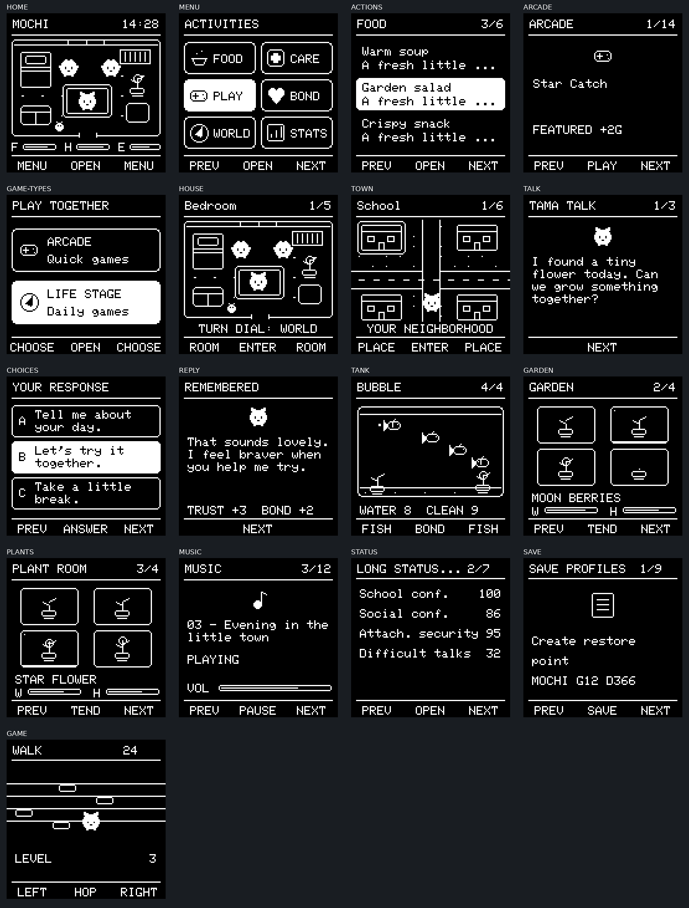

# Tamachibi: native square UI

## Visual rules

This redesign uses a 128×128 SH1107 screen with square pixels and the original
Adafruit 5×7 font at size 1. The top-down home, town, room, pet, icon, fish and
plant artwork is drawn from original source primitives. No external image files
are required on the device.

| Region | Physical coordinates | Rule |
|---|---|---|
| Header | y 0–17 | Bounded title and a separate counter/time lane |
| Content | y 21–112 | Scene, list, conversation or status data |
| Footer | y 114–127 | Three equal button lanes with short labels |

The activity grid has two columns and three rows. Action lists use three rows,
with the selected action in the center. Conversation choices use three two-line
cards. The garden and plant room use four independent planters per page. No
labels are placed on top of character eyes, furniture or fish. Spouse, children
and companion appearances still follow their existing game-state flags, with
reserved floor positions.

## Supporting pages and mini-games

The former vertical framebuffer scaler is removed. `GameDisplay` now collects
supporting-page text and artwork separately. It discards obsolete container
chrome, rebuilds readable text rows, wraps long sentences, right-aligns scalar
values, and gives artwork a separate region. A uniform fit preserves its aspect
ratio. It never scales x and y independently. Selection highlights follow their
corresponding text rows.

Twenty-two mini-game entry points use `GameScope`. This preserves their complete
64-row playfield, including objects at the bottom edge, and supplies short
control labels. Physics, collisions, progress, rewards, saves and button input
are retained. The old game playfield geometry is **not** re-authored as a new
128-row simulation; its artwork is fitted without distortion while the HUD and
navigation use the new screen layout.

Dense supporting pages rotate through marked sections every five seconds. The
section timer resets when the text page changes. Long conversation text uses
manual up/down navigation, and the main dialogue flow remains select-to-advance.

## Rendering and validation



`tools/render_ui.py` extracts the actual drawing functions from the firmware,
compiles them together with `NativeUI.cpp`, `GameDisplay.cpp` and the actual
Adafruit GFX implementation, then exports the resulting pixels. Only the OLED
transport, Arduino Print/time and state fixtures are mocked. These are rendered
screenshots, not an artist's mockup. The 17 fixtures cover home, activities, action lists, arcade selection, game types, house,
town, dialogue, response choices, reply, aquarium, garden, plants, music, status,
save profiles and a mini-game playfield.

Run from the repository root:

```sh
python3 -m platformio run -d ESP32_Tamachibi_v47_ESP32U
python3 tools/render_ui.py
```

The host renderer requires Python, Pillow and a C++17 compiler. Pass `--gfx PATH`
if Adafruit GFX is installed outside the PlatformIO dependency directory.

## Hardware

Main display: confirmed MC01506 module, SH1107, 128×128. SDA is GPIO21, SCL is
GPIO22, VCC is 3V3, and GND is common ground. The address scan supports 0x3C and
0x3D (the board's 8-bit 0x78 / 0x7A markings). The small status OLED remains a
separate SSD1306 on GPIO16 / GPIO17. Wiring and music file paths are unchanged.

## Verification limits

The host fixtures validate selected rendering states. They do not emulate all
interactive paths, physical I²C orientation, button debounce or the audio board.
A physical-device pass through activities, dialogue, settings and music is still
needed after flashing.


## Verified build

- Full ESP32 firmware build: **passed**, PlatformIO `espressif32@8.0.0`,
  Arduino-ESP32 **3.3.12**, target `esp32dev`, `min_spiffs.csv` partitions.
- Static RAM: **32,700 / 327,680 bytes**. Application flash:
  **1,282,664 / 1,966,080 bytes**.
- Host renderer: **17 fixtures generated** with the real Adafruit GFX library.
- Renderer invariants: **passed** for square circles, preservation of bottom-edge
  game pixels, isolation of text from scene pixels, and native frame lifetime
  across scoped drawing calls.
- `git diff --check`: **passed**.

The firmware binary was compiled, not uploaded to a physical board here.
